<div align="center">

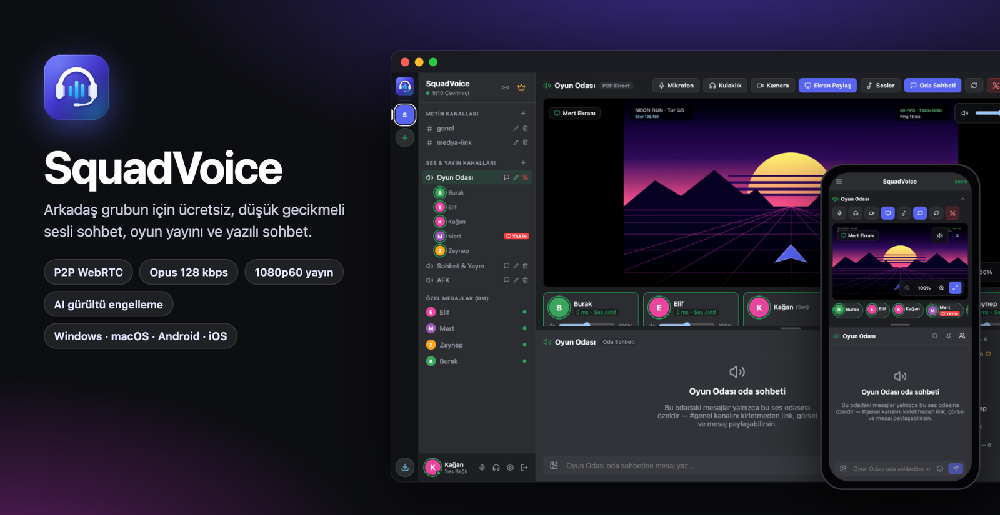

# SquadVoice

**Arkadaş grubun için ücretsiz, düşük gecikmeli sesli sohbet, oyun/ekran yayını ve yazılı sohbet.**

Oda başına 10 kişi · Sunucusuz Firebase altyapısı · Ses ve görüntü P2P WebRTC ile doğrudan akar

[](https://github.com/Kaandnz/SquadVoice/actions/workflows/deploy-firebase.yml)
[](https://github.com/Kaandnz/SquadVoice/actions/workflows/build-desktop.yml)
[](https://github.com/Kaandnz/SquadVoice/actions/workflows/build-android.yml)


[**Özellikler**](#-özellikler) · [**Ekran Görüntüleri**](#-ekran-görüntüleri) · [**Mimari**](#-mimari) · [**Kurulum**](#-kurulum-100-ücretsiz-firebase) · [**İndir**](https://github.com/Kaandnz/SquadVoice/releases/tag/latest)

</div>

---

## İçindekiler

- [Neden SquadVoice?](#-neden-squadvoice)
- [Ekran Görüntüleri](#-ekran-görüntüleri)
- [Özellikler](#-özellikler)
  - [Ses](#-ses)
  - [Ekran & Oyun Yayını, Kamera](#-ekran--oyun-yayını-kamera)
  - [Yazılı Sohbet & DM](#-yazılı-sohbet--dm)
  - [Odalar, Davetler & Yönetim](#-odalar-davetler--yönetim)
  - [Platformlar](#-platformlar)
- [Mimari](#-mimari)
- [Teknoloji Yığını](#-teknoloji-yığını)
- [Proje Yapısı](#-proje-yapısı)
- [Kurulum: %100 Ücretsiz Firebase](#-kurulum-100-ücretsiz-firebase)
- [Mobil Veri / CGNAT için Cloudflare TURN](#-mobil-veri--cgnat-için-cloudflare-turn)
- [Masaüstü, Android ve iOS](#-masaüstü-android-ve-ios)
- [Alternatif: Kendi Rust Sunucun](#-alternatif-kendi-rust-sunucun)
- [Ortam Değişkenleri](#-ortam-değişkenleri)
- [Veri Modeli & Güvenlik](#-veri-modeli--güvenlik)
- [Geliştirme & Testler](#-geliştirme--testler)
- [CI/CD](#-cicd)
- [Sorun Giderme](#-sorun-giderme)

---

## 💡 Neden SquadVoice?

SquadVoice, küçük bir arkadaş grubunun (oda başına en fazla **10 kişi**) oyun oynarken ya da takılırken kullanacağı, Discord benzeri ama **tamamen kendine ait** bir iletişim uygulamasıdır.

| | |
|---|---|
| 💸 **Sıfır maliyet** | Firebase Spark planı (kredi kartı yok) + GitHub Actions + isteğe bağlı Cloudflare TURN (ayda 1.000 GB ücretsiz). |
| ⚡ **Düşük gecikme** | Ses ve görüntü bir sunucudan geçmez: katılımcılar arasında doğrudan **P2P WebRTC** ile akar. Firebase yalnızca oturum açma, sohbet ve WebRTC sinyalleşmesi için kullanılır. |
| 🎧 **Ses kalitesi önce gelir** | Opus 64/96/128 kbps, stereo, FEC, yapay zekâ ile gürültü engelleme (RNNoise, GTCRN, DeepFilterNet 3), akıllı gürültü kapısı, kişi başı %200'e kadar ses yükseltme. |
| 🎮 **Oyuna uygun** | 1080p60 ekran yayını, sistem sesi paylaşımı, masaüstünde oyun içindeyken bile çalışan **global Bas-Konuş**. |
| 📱 **Her yerde** | Web, Windows, macOS, Android (arka planda kesintisiz ses) ve iOS (PWA). Tek bir React kod tabanı. |
| 🔐 **Davetle girilir** | Her oda bir davet koduyla korunur; kurallar sunucu tarafında (Firebase Security Rules) zorunlu kılınır. |

---

## 📸 Ekran Görüntüleri

> Aşağıdaki görüntüler uygulamanın gerçek arayüzünden alınmıştır (yerel Firebase emülatörü üzerinde, demo kullanıcılarla).

### Giriş & Kayıt

<p align="center">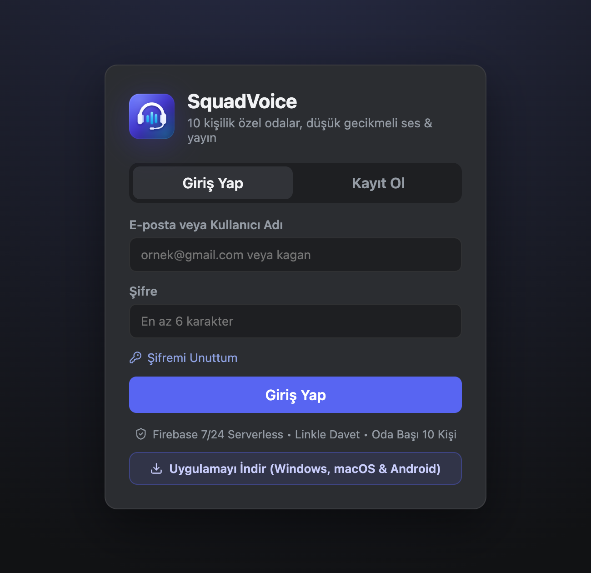</p>

E-posta veya kullanıcı adıyla giriş, davet koduyla kayıt, şifre sıfırlama. Bir davet linkiyle (`?davet=KOD`) gelen kullanıcı hesap açınca odaya otomatik katılır.

### Yazılı Sohbet

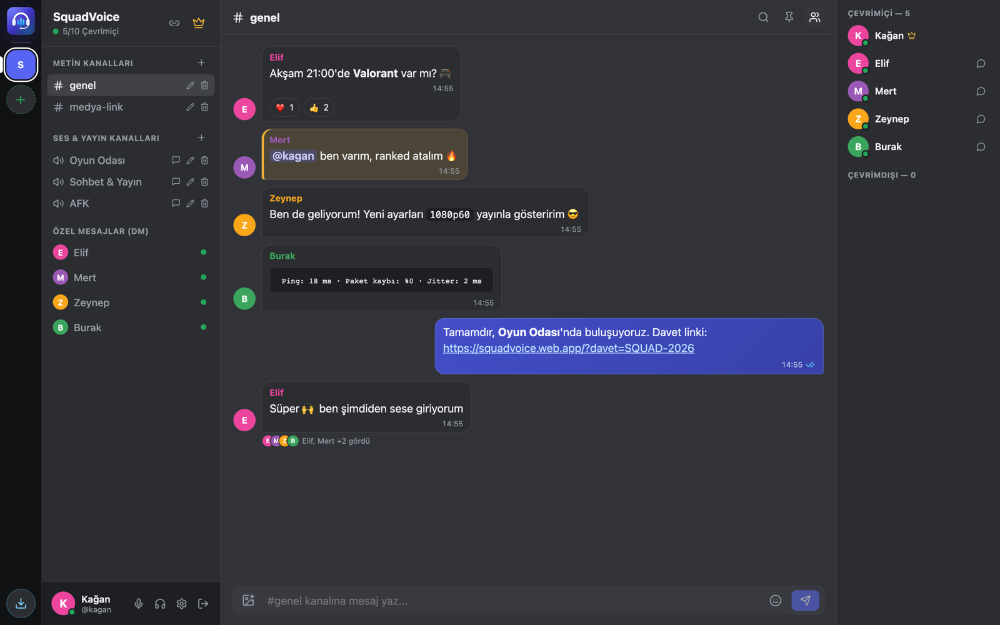

Markdown (**kalın**, *italik*, `kod`, kod blokları), `@bahsetme` vurgusu, tıklanabilir linkler, emoji tepkileri, okundu bilgisi ("… gördü"), sağda çevrimiçi/çevrimdışı üye listesi, solda metin kanalları, ses kanalları ve DM'ler.

### Ses Odası

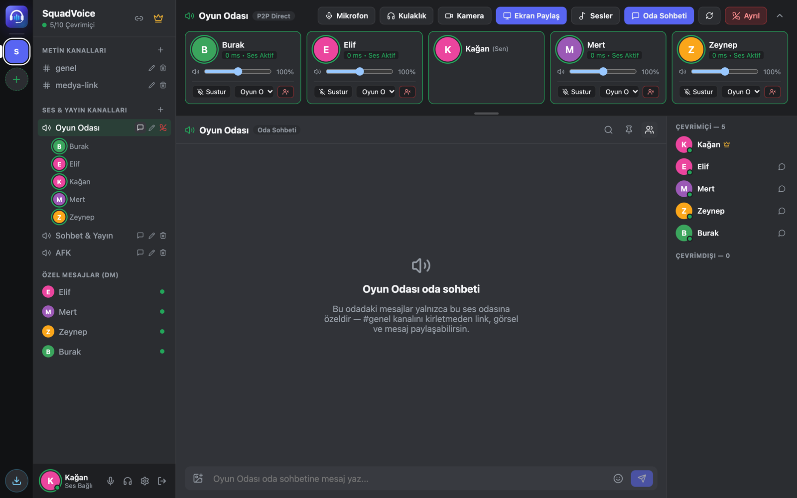

Her katılımcı için kart: konuşma göstergesi, anlık ping, **%0–%200** kişisel ses seviyesi, admin için *Sustur*, *başka kanala taşı* ve *sesten at*. Üst çubukta bağlantı türü (**P2P Direct** / TURN Relay), mikrofon, kulaklık, kamera, ekran paylaşımı, soundboard, oda sohbeti, bağlantıyı yenile ve ayrıl. Ses alanı sürüklenerek yeniden boyutlandırılabilir; yükseklik tarayıcıda hatırlanır.

### Ekran & Oyun Yayını

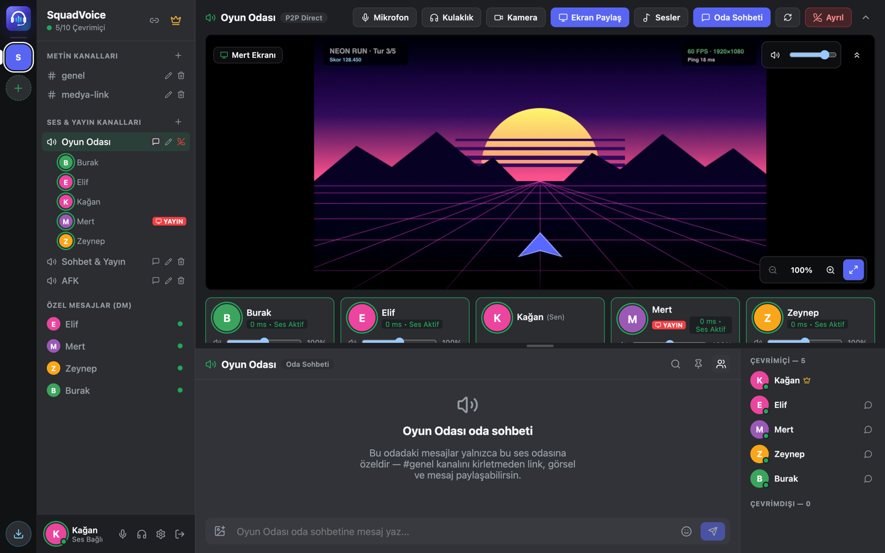

Yayın büyük sahnede açılır; yayın sesi için ayrı ses seviyesi, **1×–4× yakınlaştırma** (sürükleyerek kaydırma, mobilde çift dokunma), tam ekran ve yayını küçültüp sesi dinlemeye devam etme. Kenar çubuğunda yayın yapan kişinin yanında kırmızı **YAYIN** rozeti görünür.

<table>
<tr>
<td width="50%">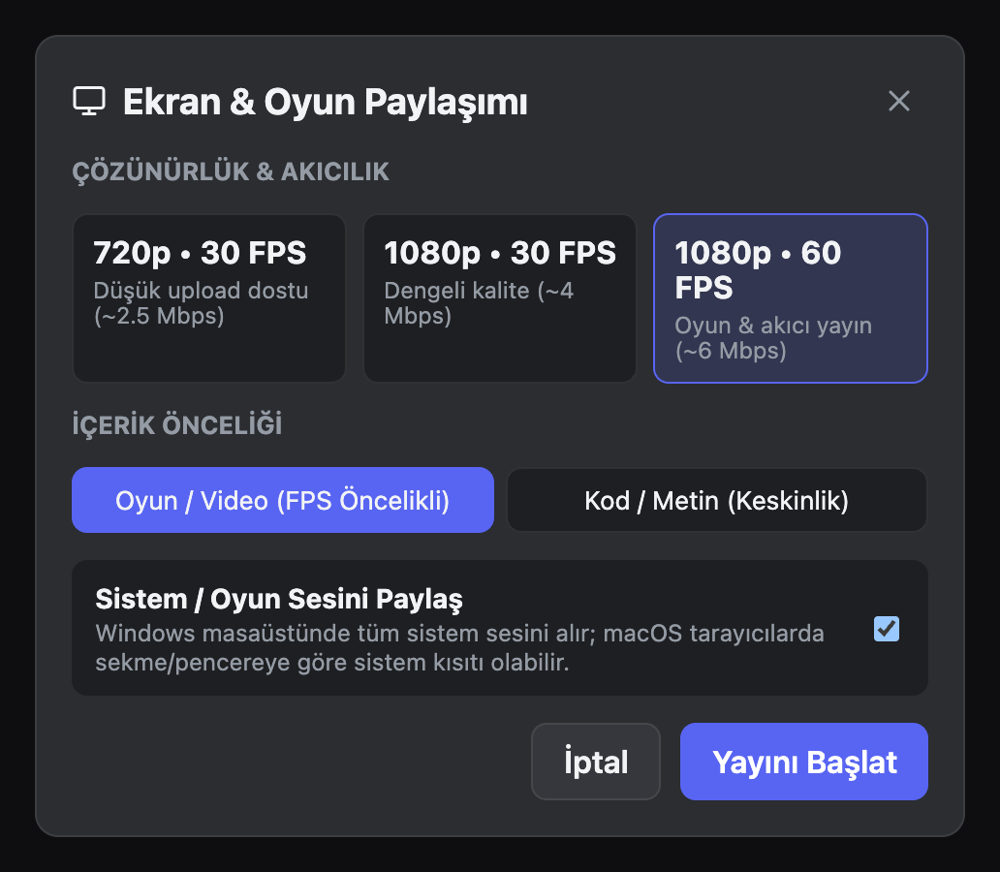</td>
<td width="50%">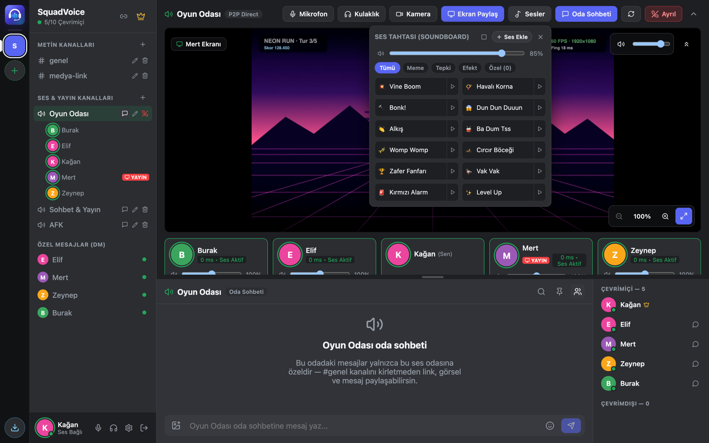</td>
</tr>
<tr>
<td><b>Yayın ayarları:</b> 720p30 (~2.5 Mbps), 1080p30 (~4 Mbps), 1080p60 (~6 Mbps). Oyun/Video (FPS öncelikli) veya Kod/Metin (keskinlik öncelikli) modu, sistem/oyun sesi paylaşımı.</td>
<td><b>Soundboard:</b> 12 hazır efekt (meme / tepki / efekt kategorileri) ve odaya özel yüklenen sesler. Herkese çal veya sadece kendin önizle.</td>
</tr>
</table>

### Mobil

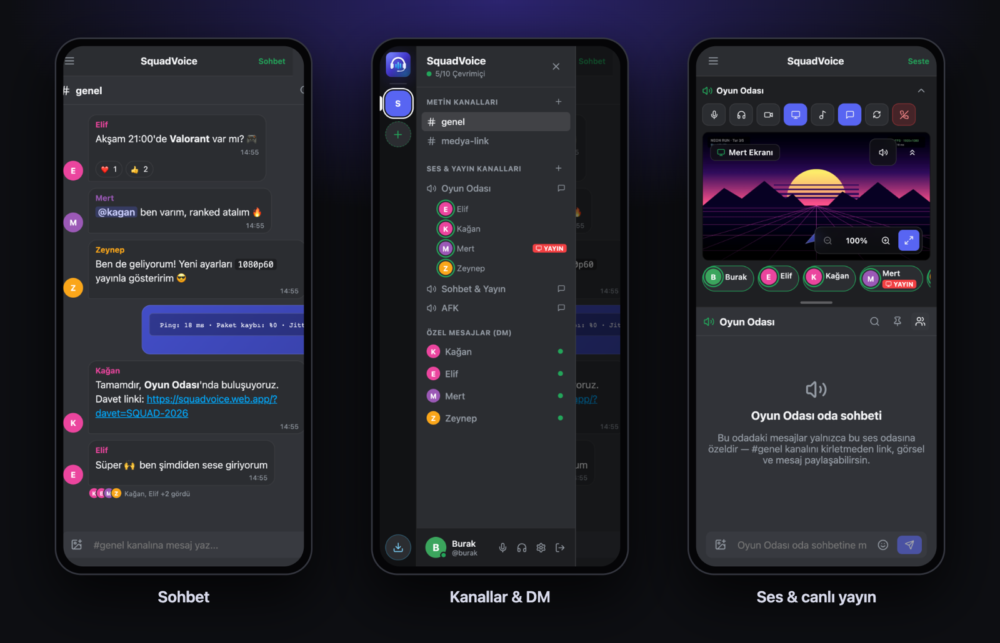

Arayüz baştan sona mobil uyumludur: açılır kenar menüsü, dokunmatik yakınlaştırma, iOS/Android ses oynatma kilidini açma, ekran kilitliyken sesin devam etmesi.

### Ayarlar

<table>
<tr>
<td width="50%">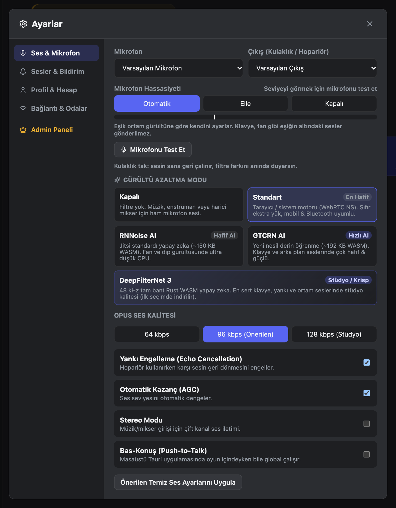</td>
<td width="50%">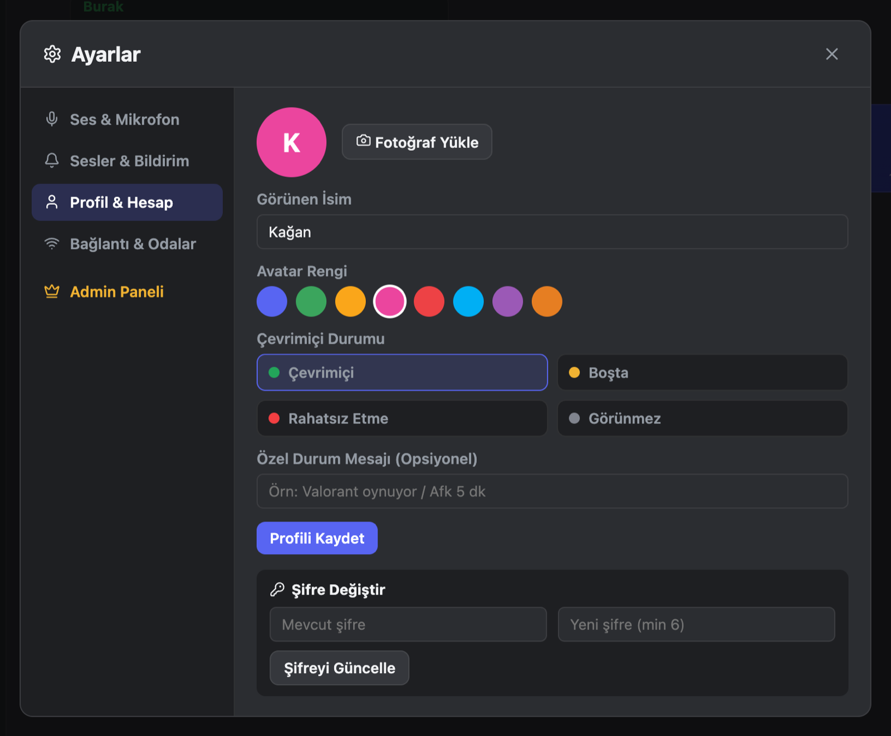</td>
</tr>
<tr>
<td><b>Ses & Mikrofon:</b> giriş/çıkış cihazı, mikrofon hassasiyeti (Otomatik / Elle / Kapalı) ve canlı seviye göstergesi, mikrofon testi, 5 gürültü azaltma modu, Opus kalitesi, yankı engelleme, AGC, stereo, Bas-Konuş.</td>
<td><b>Profil & Hesap:</b> görünen isim, avatar rengi veya fotoğraf, durum (Çevrimiçi / Boşta / Rahatsız Etme / Görünmez), özel durum mesajı, şifre değiştirme.</td>
</tr>
<tr>
<td>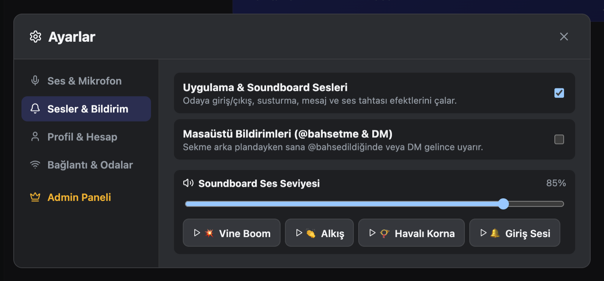</td>
<td>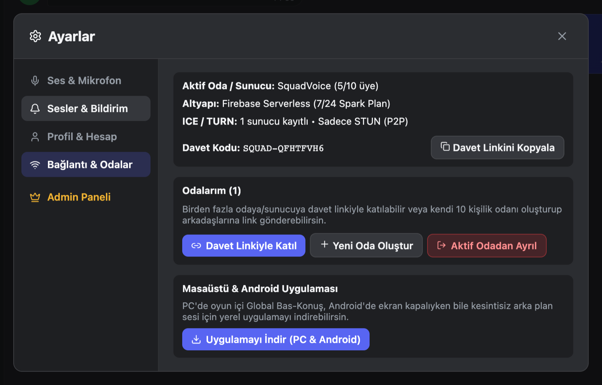</td>
</tr>
<tr>
<td><b>Sesler & Bildirim:</b> giriş/çıkış ve mesaj efektleri, @bahsetme ve DM için masaüstü bildirimleri, soundboard ses seviyesi.</td>
<td><b>Bağlantı & Odalar:</b> aktif oda, altyapı, ICE/TURN durumu, davet linki, oda listesi, uygulama indirme.</td>
</tr>
</table>

### Admin Paneli

<table>
<tr>
<td width="33%">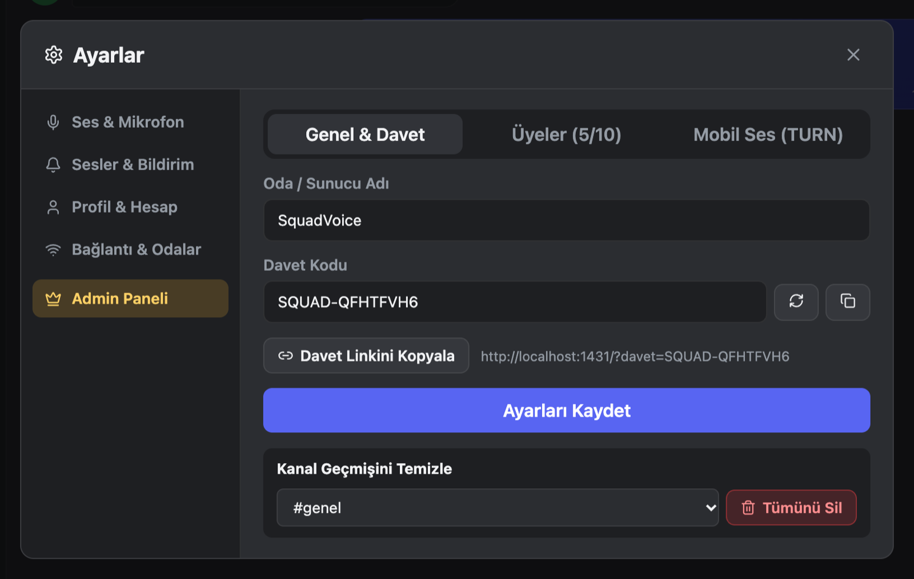</td>
<td width="33%">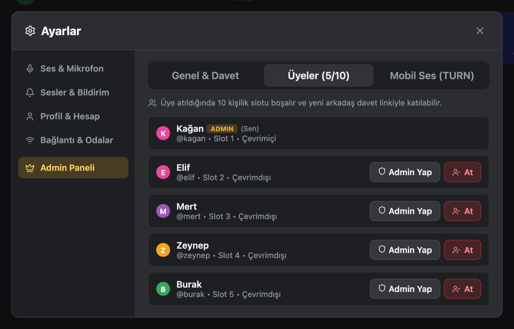</td>
<td width="33%">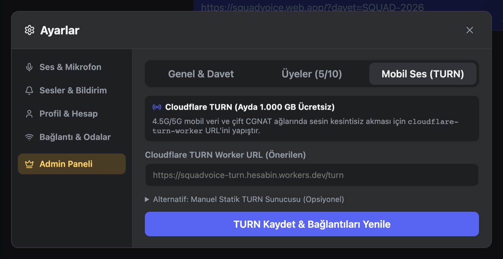</td>
</tr>
<tr>
<td><b>Genel & Davet:</b> oda adı, davet kodunu yenileme/kopyalama, kanal geçmişini temizleme.</td>
<td><b>Üyeler:</b> 10 slotluk üye listesi, admin yapma/geri alma, odadan atma.</td>
<td><b>Mobil Ses (TURN):</b> Cloudflare TURN Worker URL'si veya elle TURN sunucusu.</td>
</tr>
</table>

### Odalar & İndirme

<table>
<tr>
<td width="45%">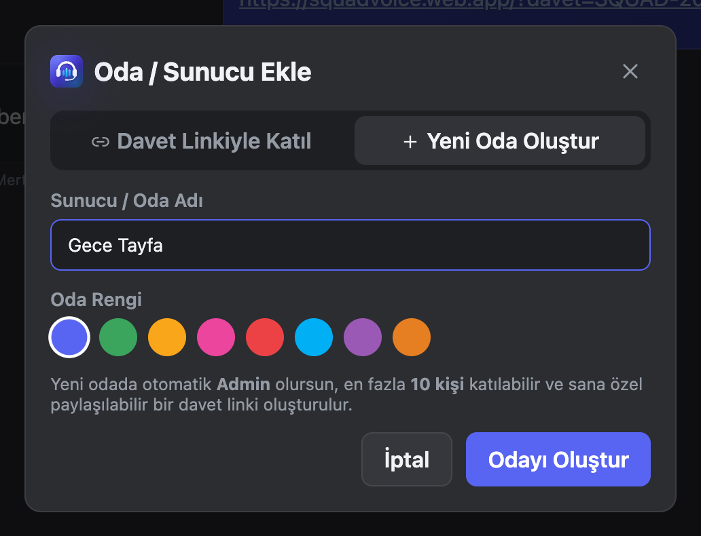</td>
<td width="55%">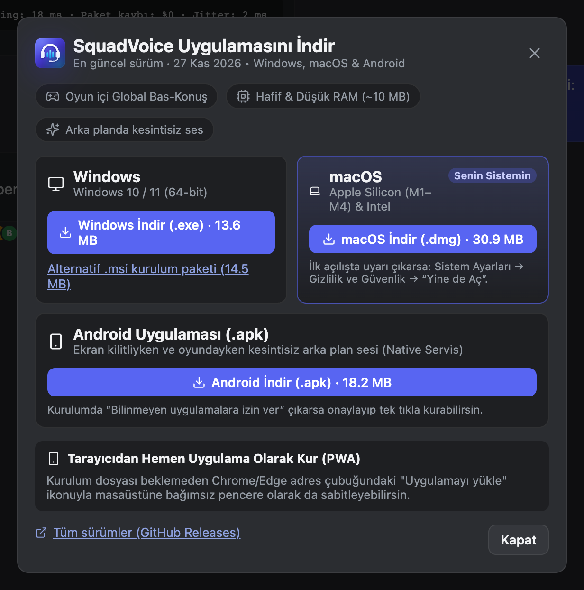</td>
</tr>
<tr>
<td><b>Oda / Sunucu Ekle:</b> davet linkiyle katıl ya da kendi 10 kişilik odanı oluştur. Oluşturan kişi otomatik admin olur.</td>
<td><b>Uygulamayı İndir:</b> işletim sistemini algılar, en güncel <code>.exe</code> / <code>.msi</code> / <code>.dmg</code> / <code>.apk</code> dosyalarını GitHub Releases'tan çeker, PWA kurulumunu anlatır.</td>
</tr>
</table>

---

## ✨ Özellikler

### 🎙 Ses

| Özellik | Ayrıntı |
|---|---|
| **Opus codec ayarı** | 64 / 96 (varsayılan) / 128 kbps. SDP'ye `useinbandfec=1` (paket kaybına karşı FEC), `usedtx`, `maxaveragebitrate`, `stereo` ve `ptime=20` yazılır ([`sdp.ts`](client/src/lib/sdp.ts)). |
| **Stereo modu** | Müzik, enstrüman veya harici mikser için iki kanallı iletim. |
| **Gürültü azaltma (5 mod)** | `Kapalı` · `Standart` (tarayıcının WebRTC NS'i) · `RNNoise AI` (~150 KB WASM) · `GTCRN AI` (~192 KB WASM) · `DeepFilterNet 3` (48 kHz tam bant, Rust WASM). AI modları AudioWorklet içinde çalışır ve yalnızca seçilince indirilir; desteklenmeyen cihazda uyarıyla güvenli moda düşer ([`noiseSuppression.ts`](client/src/lib/noiseSuppression.ts), [`noiseWorklet.ts`](client/src/lib/noiseWorklet.ts)). |
| **Mikrofon hassasiyeti (gürültü kapısı)** | `Otomatik`: ortam gürültüsünü izleyip eşiği kendisi ayarlar. `Elle`: -80…-10 dBFS eşik. `Kapalı`: her şeyi gönderir. Histerezis ve "hangover" sayesinde kelime sonları kesilmez; ölçüm 20 ms'de bir yapılır ([`audioGate.ts`](client/src/lib/audioGate.ts)). |
| **Yankı engelleme / AGC** | Tarayıcı/sistem AEC ve otomatik kazanç açılıp kapatılabilir. |
| **Kişi başı ses seviyesi** | Her arkadaş için %0–%200 arası; %100'ün üstünde bir limiter devreye girerek bozulmayı önler. Ayarlar tarayıcıda hatırlanır. |
| **Bas-Konuş (Push-to-Talk)** | Varsayılan tuş `` ` `` (Backquote). Tauri masaüstü uygulamasında **global kısayol** olarak çalışır, yani oyun penceresi öndeyken bile. |
| **Mikrofon testi** | Görüşmeye girmeden kendi sesini canlı seviye göstergesiyle dinle. |
| **Cihaz seçimi** | Giriş ve çıkış (hoparlör/kulaklık) cihazı; cihaz çıkarılırsa otomatik toparlanma. |
| **Konuşan göstergesi** | Konuşan kişinin avatarı yeşil halkayla vurgulanır. |
| **Bağlantı ayrıntıları** | Kişi başına son bir dakikalık ping, paket kaybı ve jitter grafiği; P2P mi TURN üzerinden mi bağlanıldığı ([`ConnectionDetails.tsx`](client/src/components/ConnectionDetails.tsx)). |
| **Sağlam bağlantı** | "Perfect negotiation", ICE kopmasında 4 sn sonra otomatik ICE restart, yanıtlanmayan teklifleri 8 sn → 60 sn geri çekilmeyle yeniden gönderme, karşı taraf bağlantısını yeniden kurduğunda bunu SDP `o=` oturum kimliğinden algılayıp eşleme ([`webrtcMesh.ts`](client/src/lib/webrtcMesh.ts)). |
| **Çoklu cihaz farkındalığı** | Aynı hesapla başka bir sekme veya cihazda sesteysen uyarı bandı çıkar; ses oturumu tek bir cihaza aittir. |
| **Mobilde kesintisiz ses** | Wake Lock, Media Session kontrolleri, sessiz ses döngüsü ile sekmenin önceliği korunur; Android uygulamasında yerel Foreground Service bildirimi üzerinden sustur/kapat ([`mobileVoiceKeepAlive.ts`](client/src/lib/mobileVoiceKeepAlive.ts), [`VoiceCallService.java`](client/android/app/src/main/java/com/squadvoice/app/VoiceCallService.java)). |

### 🖥 Ekran & Oyun Yayını, Kamera

- **Presetler:** 720p30 (~2.5 Mbps), 1080p30 (~4 Mbps), 1080p60 (~6 Mbps).
- **İçerik önceliği:** *Oyun/Video* (`contentHint: motion`, FPS korunur) veya *Kod/Metin* (`detail`, keskinlik korunur).
- **Sistem/oyun sesi:** Windows'ta tüm sistem sesi, tarayıcılarda sekme/pencere sesi. Kendi uygulamanın çaldığı arkadaş seslerinin tekrar yayına karışmaması için yerel oynatma bastırılır.
- **İzleyici tarafı:** yayına odaklanma, yayın sesi kaydırıcısı, 1×–4× yakınlaştırma ve kaydırma, tam ekran, yayını küçültüp sadece sesini dinleme.
- **Kamera:** ses odasında kamera açıp kapatma.
- **Android'de ekran paylaşımı:** WebView `getDisplayMedia` desteklemediği için yerel `MediaProjection` + `VirtualDisplay` servisi ekranı yakalar ve kareleri WebRTC'ye aktarır ([`ScreenShareService.java`](client/android/app/src/main/java/com/squadvoice/app/ScreenShareService.java), [`nativeScreenShare.ts`](client/src/lib/nativeScreenShare.ts)).

### 💬 Yazılı Sohbet & DM

- Metin kanalları ve **her ses kanalına özel oda sohbeti** (#genel kirlenmeden link ve görsel paylaşımı).
- **Özel mesajlar (DM)**: oda üyeleriyle birebir sohbet.
- Markdown: `**kalın**`, `*italik*`, `` `kod` ``, ```` ``` ```` kod blokları, otomatik link ve `@kullanıcı` bahsetmeleri ([`markdown.ts`](client/src/lib/markdown.ts)).
- Emoji tepkileri, yanıtlama, sabitleme (sabitlenmiş mesajlar paneli), düzenleme, silme, mesaj içinde arama.
- Görsel gönderme (dosya seçme veya **Ctrl+V** ile yapıştırma); görseller tarayıcıda 1280 px'e küçültülüp sıkıştırılır ([`imageCompress.ts`](client/src/lib/imageCompress.ts)).
- "Yazıyor…" göstergesi, okundu bilgisi, eski mesajları kaydırarak yükleme.
- Arka plandayken @bahsetme ve DM için masaüstü bildirimi.

### 🏠 Odalar, Davetler & Yönetim

- Bir hesap **birden fazla odaya** (sunucuya) üye olabilir; sol şeritten odalar arasında geçilir.
- Oda oluşturan kişi admin olur; her oda en fazla **10 üye** alır (slot sistemi).
- Davet: `SQUAD-XXXX` kodu veya `https://…/?davet=KOD` linki. Linkle gelen ve henüz hesabı olmayan kişi kayıttan sonra odaya otomatik katılır.
- **Admin araçları:** oda adı, davet kodunu yenileme, üyeyi admin yapma/atma, kanal oluşturma/yeniden adlandırma/silme, kanal geçmişini temizleme, sesteki birini zorla susturma, başka ses kanalına taşıma veya sesten atma, TURN ayarı.
- Kullanıcı durumu (Çevrimiçi / Boşta / Rahatsız Etme / Görünmez) ve özel durum mesajı ("Valorant oynuyor").

### 📦 Platformlar

| Platform | Nasıl? | Not |
|---|---|---|
| 🌐 **Web** | Firebase Hosting | Chrome, Edge, Firefox, Safari |
| 🪟 **Windows 10/11** | Tauri 2 (`.exe` / `.msi`) | ~10 MB, global Bas-Konuş |
| 🍎 **macOS** | Tauri 2, Universal `.dmg` | Apple Silicon (M1–M4) + Intel |
| 🤖 **Android** | Capacitor 8 (`.apk`) | Arka planda kesintisiz ses, yerel ekran paylaşımı |
| 📱 **iOS / iPadOS** | PWA (Safari → Ana Ekrana Ekle) | Ücretli Apple Developer hesabı gerekmez |

---

## 🧭 Mimari

### Genel bakış

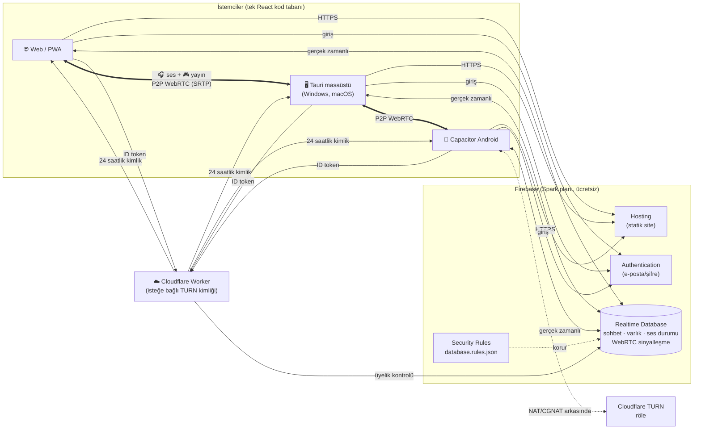

Firebase **ses taşımaz**: yalnızca kimlik doğrulama, sohbet verisi, kimin hangi ses kanalında olduğu ve WebRTC teklif/yanıt/ICE mesajları için kullanılır. Ses ve görüntü, odadaki herkesin birbirine doğrudan bağlandığı bir **mesh** üzerinden akar (10 kişiye kadar bu yaklaşım hem en düşük gecikmeyi verir hem de sunucu maliyeti doğurmaz). Doğrudan bağlantı kurulamayan ağlarda (mobil veri, CGNAT) trafik isteğe bağlı TURN rölesi üzerinden geçer.

### Bir ses kanalına katılma (sinyalleşme)

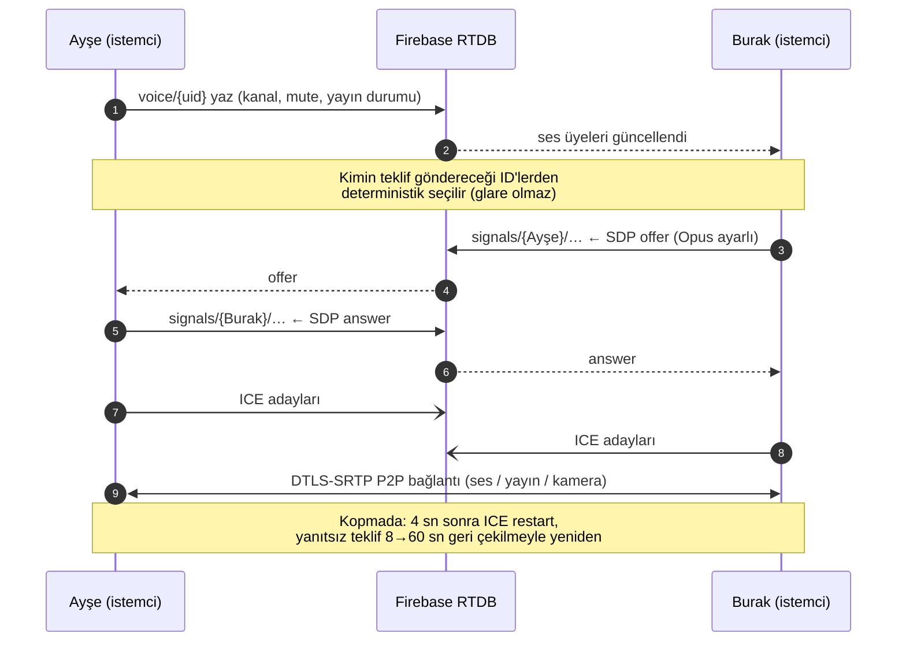

### Ses işleme hattı

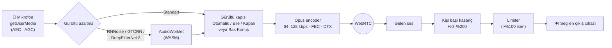

### İki arka uç modu

İstemci derlenirken `VITE_FIREBASE_*` değişkenleri doluysa **Firebase modu**, boşsa **Rust sunucu modu** açılır ([`firebase.ts`](client/src/lib/firebase.ts) → `isFirebaseEnabled()`).

| | Firebase modu (önerilen) | Rust sunucu modu |
|---|---|---|
| Barındırma | Firebase Hosting, 7/24 | Kendi PC'n / VPS / Docker |
| Kimlik | Firebase Auth | Argon2 şifre + JWT |
| Veri | Realtime Database | SQLite |
| Gerçek zamanlı | RTDB dinleyicileri | WebSocket (`/ws`) |
| Çoklu oda, DM, tepkiler, soundboard, okundu bilgisi | ✅ | Temel set (kanallar, mesaj, dosya yükleme, ses, yayın) |
| Maliyet | 0 ₺ | Sunucuna bağlı |

---

## 🧱 Teknoloji Yığını

| Katman | Teknoloji |
|---|---|
| Arayüz | React 19, TypeScript 5.7, Zustand 5, lucide-react ikonları, saf CSS |
| Derleme | Vite 6 (Firebase, React ve ikonlar ayrı, uzun süre önbelleklenen parçalara bölünür) |
| Gerçek zamanlı | Firebase Authentication + Realtime Database (v11 modüler SDK) |
| Medya | WebRTC (mesh, perfect negotiation), Web Audio API, AudioWorklet |
| Gürültü engelleme | `@sapphi-red/web-noise-suppressor` (RNNoise, GTCRN), `@lofcz/deepfilternet-web` (DeepFilterNet 3) |
| Masaüstü | Tauri 2 + `tauri-plugin-global-shortcut` |
| Mobil | Capacitor 8 + yerel Java servisleri (Foreground Service, MediaProjection) |
| TURN | Cloudflare Workers + Cloudflare Realtime TURN |
| Alternatif sunucu | Rust: Axum 0.8, Tokio, rusqlite, argon2, jsonwebtoken |
| Test | Vitest + jsdom (birim), Playwright (gerçek tarayıcıda iki uçlu arama), `cargo test` |
| CI/CD | GitHub Actions → Firebase Hosting, GitHub Releases, Firebase App Distribution |

---

## 🗂 Proje Yapısı

```text
SquadVoice/
├── client/                         # Tek React uygulaması (web + masaüstü + mobil)
│   ├── src/
│   │   ├── App.tsx                 # Ana iskelet: kenar çubuğu, ses alanı, sohbet, modallar
│   │   ├── components/             # Sidebar, VoiceStage, ChatPanel, SettingsModal, AdminPanel…
│   │   ├── lib/
│   │   │   ├── firebaseBackend.ts  # Firebase üzerinden tüm veri işlemleri ve sinyalleşme
│   │   │   ├── webrtcMesh.ts       # P2P mesh, yeniden bağlanma, istatistikler
│   │   │   ├── audioEngine.ts      # Mikrofon, gürültü kapısı, kişi başı kazanç, çıkış cihazı
│   │   │   ├── noiseWorklet.ts     # RNNoise / GTCRN / DeepFilterNet 3 worklet'leri
│   │   │   ├── sdp.ts              # Opus ayarı ve negotiation kuralları
│   │   │   ├── sounds.ts           # Web Audio ile sentezlenen efektler ve soundboard
│   │   │   ├── mobileVoiceKeepAlive.ts, nativeScreenShare.ts, platform.ts …
│   │   │   └── *.test.ts           # Vitest birim testleri
│   │   ├── store/useAppStore.ts    # Zustand: uygulamanın tüm durumu ve eylemleri
│   │   └── types/protocol.ts       # Paylaşılan tipler ve WebSocket protokolü
│   ├── e2e/                        # Playwright: iki tarayıcı arasında gerçek sesli arama testleri
│   ├── src-tauri/                  # Tauri 2 masaüstü kabuğu (Rust)
│   └── android/                    # Capacitor Android projesi + yerel Java servisleri
├── server/                         # Alternatif Rust sunucusu (Axum + SQLite + WebSocket)
├── cloudflare-turn-worker/         # Firebase üyeliğini doğrulayıp TURN kimliği veren Worker
├── database.rules.json             # Realtime Database güvenlik kuralları
├── firebase.json / .firebaserc     # Hosting + Database + Auth yapılandırması
├── docker-compose.yml              # Rust sunucusunu tek komutla çalıştırma
├── docs/screenshots/               # README görselleri
└── .github/workflows/              # Firebase deploy, masaüstü ve Android derlemeleri
```

---

## 🚀 Kurulum: %100 Ücretsiz Firebase

### Gereksinimler

- Ücretsiz bir Google / Firebase hesabı
- Node.js 20+ (CI'da 22 kullanılır)

### 1. Firebase CLI ile giriş yap ve projeyi bağla

```bash
npx -y firebase-tools@latest login
```

```bash
npx -y firebase-tools@latest projects:create squadvoice-ekip --display-name "SquadVoice"
```

```bash
npx -y firebase-tools@latest use squadvoice-ekip
```

Mevcut bir projen varsa sadece `npx -y firebase-tools@latest use PROJE_ID` çalıştırman yeterli.

### 2. Firebase Console'da servisleri aç

1. **Authentication → Sign-in method:** `Email/Password` sağlayıcısını aç (veya `npx -y firebase-tools@latest deploy --only auth`).
2. **Realtime Database → Create Database:** bölge olarak **Belgium (`europe-west1`)**, mod olarak **Locked mode** seç.
3. **Project Settings → Your apps → Web (`</>`)** ile bir web uygulaması ekle. Verilen `firebaseConfig` değerlerini `client/.env.example` dosyasını `client/.env` olarak kopyalayıp içine yaz.

### 3. Kuralları ve uygulamayı yayınla

```bash
cd client && npm install && npm run build && cd ..
```

```bash
npx -y firebase-tools@latest deploy --only database,hosting
```

Canlı adresin hazır: `https://PROJE_ID.web.app` 🎉

- **İlk kayıt olan kişi otomatik admin olur.** Varsayılan oda için rastgele bir davet kodu üretilir; kodu **Ayarlar → Admin Paneli → Genel & Davet** bölümünden görebilir, değiştirebilir ve davet linkini kopyalayabilirsin.
- Güvenlik kuralları ([`database.rules.json`](database.rules.json)) **oda başına en fazla 10 kullanıcıyı** ve **davet kodu kontrolünü** sunucu tarafında zorunlu kılar.

### 4. Otomatik yayınlama (GitHub Actions → Firebase)

[`.github/workflows/deploy-firebase.yml`](.github/workflows/deploy-firebase.yml), `main` dalına her push'ta testleri çalıştırır, istemciyi derler ve Hosting ile Database kurallarını yayınlar. Repo → **Settings → Secrets and variables → Actions** altına şunları ekle:

| Secret / Variable | Açıklama |
|---|---|
| `FIREBASE_SERVICE_ACCOUNT` | Google Cloud Console → **IAM & Admin → Service Accounts** altında **Firebase Admin** rolüyle oluşturulan hesabın JSON anahtarı |
| `VITE_FIREBASE_API_KEY`, `VITE_FIREBASE_AUTH_DOMAIN`, `VITE_FIREBASE_DATABASE_URL`, `VITE_FIREBASE_PROJECT_ID`, `VITE_FIREBASE_STORAGE_BUCKET`, `VITE_FIREBASE_MESSAGING_SENDER_ID`, `VITE_FIREBASE_APP_ID` | Yerel `client/.env` içindeki değerler |
| `VITE_DEFAULT_INVITE_CODE` *(ops.)* | Davet kodu ipucu (varsayılan `SQUAD-2026`) |
| `VITE_TURN_WORKER_URL` *(ops.)* | Cloudflare TURN Worker adresi |

---

## 📶 Mobil Veri / CGNAT için Cloudflare TURN

İki kişi de katı NAT veya mobil operatör CGNAT'ı arkasındaysa doğrudan P2P bağlantı kurulamayabilir. Bunun için [`cloudflare-turn-worker/`](cloudflare-turn-worker/) klasöründeki küçük Worker, **yalnızca oda üyelerine** (Firebase ID token'ı ve Realtime Database üyeliği doğrulanarak) 24 saatlik geçici Cloudflare TURN kimliği üretir. API anahtarları hiçbir zaman istemciye gitmez. Cloudflare TURN ayda **1.000 GB ücretsizdir**.

1. [dash.cloudflare.com](https://dash.cloudflare.com) → **Calls / Realtime → TURN** altında bir TURN App oluştur, **TURN Token ID** ve **API Token** değerlerini al.
2. Worker'ı yayınla:

   ```bash
   cd cloudflare-turn-worker
   npx -y wrangler@latest login
   npx -y wrangler@latest secret put CF_TURN_KEY_ID
   npx -y wrangler@latest secret put CF_TURN_API_TOKEN
   npx -y wrangler@latest secret put FIREBASE_WEB_API_KEY
   npx -y wrangler@latest deploy
   ```

   `wrangler.toml` içindeki `FIREBASE_DATABASE_URL` değerini kendi veritabanı adresinle değiştirmeyi unutma.
3. Çıkan `https://squadvoice-turn.<hesabın>.workers.dev/turn` adresini **Ayarlar → Admin Paneli → Mobil Ses (TURN)** alanına yapıştır (veya `VITE_TURN_WORKER_URL` olarak derlemeye ver).

TURN kimlikleri yenilendiğinde istemci çalışan görüşmeleri koparmadan ICE sunucularını yerinde günceller. Elle bir TURN sunucusu (ör. `turn:…,turns:…`) kullanmak da mümkündür.

---

## 📲 Masaüstü, Android ve iOS

`client/.env` içinde Firebase bilgilerin varken derlenen tüm uygulamalar doğrudan senin Firebase projenle konuşur.

### Masaüstü (Tauri 2)

Kendi Mac'inde `.app` / `.dmg` üretmek için ([Rust](https://rustup.rs) gerekir):

```bash
cd client && npm run tauri build
```

Geliştirme modunda masaüstü penceresi:

```bash
cd client && npm run tauri dev
```

[`.github/workflows/build-desktop.yml`](.github/workflows/build-desktop.yml), `client/` değiştiğinde Windows (`SquadVoice-Windows-Setup.exe`, `SquadVoice-Windows.msi`) ve macOS Universal (`SquadVoice-macOS-Universal.dmg`) paketlerini derleyip GitHub Releases'taki **`latest`** sürümüne yükler. Uygulamadaki **Uygulamayı İndir** penceresi dosyaları buradan çeker.

> macOS ilk açılışta "doğrulanamayan geliştirici" uyarısı verirse: **Sistem Ayarları → Gizlilik ve Güvenlik → Yine de Aç**.

### Android (Capacitor 8)

- Ekran kapalıyken veya başka bir uygulama/oyun öndeyken ses kesilmez: yerel **Foreground Service** (`microphone|mediaPlayback`) çalışır ve bildirimden sustur/ayrıl yapılabilir.
- Ekran paylaşımı yerel `MediaProjection` servisiyle yapılır.
- [`.github/workflows/build-android.yml`](.github/workflows/build-android.yml) her `main` güncellemesinde `SquadVoice-Android.apk` üretir, GitHub Releases'a ve (servis hesabı tanımlıysa) **Firebase App Distribution**'a yükler.

Yerel derleme:

```bash
cd client && npm run build && npx cap sync android && cd android && ./gradlew assembleDebug
```

### iPhone / iPad

Safari'de `https://PROJE_ID.web.app` adresini aç → **Paylaş → Ana Ekrana Ekle**. Tam ekran, bağımsız bir uygulama gibi çalışır. (Ücretli Apple Developer hesabı olmadan `.ipa` imzalanamaz; ücretsiz sideload isteyenler AltStore / SideStore kullanabilir.)

---

## 🦀 Alternatif: Kendi Rust Sunucun

Firebase yerine kendi makinende çalıştırmak istersen istemciyi `VITE_FIREBASE_*` değişkenleri **boş** olacak şekilde derle; uygulama otomatik olarak Rust sunucusuna bağlanır. Sunucu, derlenmiş istemciyi de (`STATIC_DIR`) kendisi sunar.

```bash
cd server && cp .env.example .env && cargo run --release
```

veya Docker ile (istemciyi de derleyen çok aşamalı imaj):

```bash
docker compose up -d
```

Dışarıya açmak için hızlı yol:

```bash
cloudflared tunnel --url http://localhost:3001
```

Alan adın varsa `docker-compose.yml` içindeki Caddy servisini açarak otomatik Let's Encrypt HTTPS alabilirsin.

<details>
<summary><b>REST API ve WebSocket protokolü</b></summary>

| Metot | Yol | Açıklama |
|---|---|---|
| `GET` | `/api/health` | Sağlık kontrolü |
| `POST` | `/api/auth/register` | Davet koduyla kayıt (ilk kullanıcı admin) |
| `POST` | `/api/auth/login` | Giriş, JWT döner |
| `GET` | `/api/auth/me` | Oturumdaki kullanıcı |
| `GET` | `/api/users` | Kullanıcı listesi |
| `GET` / `POST` | `/api/channels` | Kanalları listele / oluştur |
| `DELETE` | `/api/channels/{id}` | Kanal sil (admin) |
| `GET` | `/api/channels/{id}/messages` | Mesaj geçmişi |
| `POST` | `/api/uploads` | Dosya yükleme (en fazla 9 MB) |
| `GET` | `/api/rtc-config` | ICE sunucuları (Cloudflare TURN veya elle TURN) |
| `GET` | `/ws` | Gerçek zamanlı WebSocket |
| `GET` | `/uploads/*` | Yüklenen dosyalar |

**İstemci → sunucu:** `ping`, `send_message`, `join_voice`, `leave_voice`, `voice_state_update`, `speaking`, `rtc_offer`, `rtc_answer`, `rtc_ice_candidate`

**Sunucu → istemci:** `pong`, `ready`, `presence_update`, `voice_members_update`, `user_speaking`, `message_created`, `channel_created`, `channel_deleted`, `rtc_offer`, `rtc_answer`, `rtc_ice_candidate`, `error`

Tipler: [`client/src/types/protocol.ts`](client/src/types/protocol.ts) ve [`server/src/ws.rs`](server/src/ws.rs).

</details>

---

## 🔧 Ortam Değişkenleri

### İstemci (`client/.env`)

| Değişken | Zorunlu | Açıklama |
|---|---|---|
| `VITE_FIREBASE_API_KEY` | Firebase modu | Web uygulaması yapılandırmasından |
| `VITE_FIREBASE_AUTH_DOMAIN` | Firebase modu | 〃 |
| `VITE_FIREBASE_DATABASE_URL` | Firebase modu | Realtime Database adresi |
| `VITE_FIREBASE_PROJECT_ID` | Firebase modu | 〃 |
| `VITE_FIREBASE_STORAGE_BUCKET` | – | 〃 |
| `VITE_FIREBASE_MESSAGING_SENDER_ID` | – | 〃 |
| `VITE_FIREBASE_APP_ID` | Firebase modu | 〃 |
| `VITE_DEFAULT_INVITE_CODE` | – | Davet kodu ipucu (varsayılan `SQUAD-2026`) |
| `VITE_GITHUB_REPO` | – | İndirme penceresinin sürümleri çekeceği repo (varsayılan `Kaandnz/SquadVoice`) |
| `VITE_TURN_WORKER_URL` | – | Cloudflare TURN Worker adresi |
| `VITE_TURN_URL`, `VITE_TURN_USERNAME`, `VITE_TURN_CREDENTIAL` | – | Elle TURN sunucusu |

### Rust sunucusu (`server/.env`)

| Değişken | Varsayılan | Açıklama |
|---|---|---|
| `HOST` / `PORT` | `0.0.0.0` / `3001` | Dinlenen adres |
| `DATA_DIR` | `./data` | SQLite veritabanı, yüklemeler ve JWT anahtarı |
| `STATIC_DIR` | `../client/dist` | Sunulacak derlenmiş istemci |
| `INVITE_CODE` | `SQUAD-2026` | Kayıt için davet kodu |
| `MAX_USERS` | `10` (örnek dosyada `5`) | En fazla kullanıcı |
| `JWT_SECRET` | otomatik | Boşsa ilk açılışta `DATA_DIR/jwt_secret.key` üretilir |
| `CLOUDFLARE_TURN_KEY_ID`, `CLOUDFLARE_TURN_API_TOKEN` | – | Cloudflare TURN |
| `TURN_URL`, `TURN_USERNAME`, `TURN_CREDENTIAL` | – | Elle TURN |

### Cloudflare Worker

| Değişken | Tür | Açıklama |
|---|---|---|
| `CF_TURN_KEY_ID` | secret | Cloudflare TURN Token ID |
| `CF_TURN_API_TOKEN` | secret | Cloudflare TURN API Token |
| `FIREBASE_WEB_API_KEY` | secret | ID token doğrulaması için Firebase web API anahtarı |
| `FIREBASE_DATABASE_URL` | `wrangler.toml` | Üyelik kontrolü yapılacak veritabanı |

---

## 🛡 Veri Modeli & Güvenlik

Realtime Database ağacının ana hatları:

```text
/users/{uid}                    profil (isim, renk, avatar, durum, rol)
/userRooms/{uid}/{roomId}       kullanıcının üye olduğu odalar
/invites/{code}                 davet kodu → oda eşlemesi
/rooms/{roomId}/
    meta                        oda adı, renk, davet kodu
    members/{uid}               rol (admin | member)
    slots/{1..10}               10 kişilik slotlar
    channels/{channelId}        metin ve ses kanalları
    messages/{channelId}/{id}   mesajlar (tepkiler, sabitleme, yanıt)
    readReceipts · typing       okundu bilgisi, yazıyor göstergesi
    presence/{uid}              çevrimiçi durumu (onDisconnect ile)
    voice/{uid}                 ses durumu (kanal, mute, yayın, kamera)
    voice_kicks/{uid}           admin tarafından sesten atma
    signals/{targetUid}/{id}    WebRTC offer / answer / ICE
    soundboard · customSounds   soundboard olayları ve özel sesler
    turn                        oda TURN ayarı
/dms/{uidA__uidB}/{id}          birebir mesajlar
/dmReadReceipts/{pairId}/{uid}  DM okundu bilgisi
```

[`database.rules.json`](database.rules.json) şunları sunucu tarafında garanti eder:

- Bir odanın kanalları, mesajları ve ses durumu yalnızca **o odanın üyelerine** açıktır; WebRTC sinyallerini yalnızca alıcısı okuyabilir.
- Oda başına yalnızca `1…10` slotu vardır; bir slotu sadece sahibi alabilir veya bırakabilir (admin boşaltabilir).
- Kullanıcı kendi `role`, `username` ve `created_at` alanlarını değiştiremez; rol değişikliği yalnızca admin tarafından yapılır.
- Mesajları yalnızca yazarı düzenleyebilir; silme yazara ve admine açıktır. İçerik 4.000 karakter, ek (data URL) 350.000 karakter ile sınırlıdır.
- DM'leri yalnızca iki taraf okuyup yazabilir.
- Davet kodları ve TURN ayarları yalnızca admin tarafından değiştirilebilir.

---

## 🧪 Geliştirme & Testler

```bash
cd client && npm install
```

Geliştirme sunucusu (`http://localhost:1420`; `/api`, `/ws`, `/uploads` istekleri `127.0.0.1:3001`'deki Rust sunucusuna yönlendirilir):

```bash
cd client && npm run dev
```

| Komut | Ne yapar? |
|---|---|
| `npm run typecheck` | Uygulama ve e2e harness için TypeScript kontrolü |
| `npm test` | Vitest birim testleri (23 test dosyası: SDP, gürültü kapısı, ses motoru, Firebase arka ucu, davet, markdown, bağlantı kalitesi, mobil keep-alive…) |
| `npm run test:e2e` | Playwright ile **iki gerçek tarayıcı arasında** sesli arama testleri |
| `cargo test` (`server/`) | Rust sunucusu için API + WebSocket entegrasyon testleri |

Uçtan uca testler ([`client/e2e/call.spec.ts`](client/e2e/call.spec.ts)) sahte mikrofonla iki eşi gerçekten bağlar ve şu senaryoları doğrular:

- Görüşme dışında mikrofon testi canlı seviye göstergesiyle sesi geri çalar
- Bağlantı kurulur ve ses iki yönde akar
- Yalnızca bir taraf ya da iki taraf aynı anda bağlantıyı yeniden kurduğunda görüşme toparlanır
- ICE sunucuları değiştiğinde görüşme kopmaz
- Görüşme ortasında mikrofon değiştirildiğinde ses akmaya devam eder
- Mikrofon hassasiyeti gönderilen sesi gerçekten keser; "Kapalı" her şeyi gönderir
- Aynı kişinin ikinci bir oturumu yeniden bağlanma fırtınasına yol açmaz
- Sinyalleşmede bir yanıt kaybolsa bile görüşme kurtarılır

---

## 🔄 CI/CD

| Workflow | Tetikleyici | Adımlar | Çıktı |
|---|---|---|---|
| [`deploy-firebase.yml`](.github/workflows/deploy-firebase.yml) | `main` push, PR | Kuralları doğrula → typecheck → Vitest → Playwright e2e → build → deploy | Firebase Hosting + Database kuralları (PR'larda yalnızca test) |
| [`build-desktop.yml`](.github/workflows/build-desktop.yml) | `client/**` değişikliği | Windows + macOS Universal Tauri derlemesi | `latest` GitHub Release: `.exe`, `.msi`, `.dmg` |
| [`build-android.yml`](.github/workflows/build-android.yml) | `client/**` değişikliği | Web build → `cap sync` → Gradle (`versionCode` = run numarası + 10) | `latest` GitHub Release: `.apk` + Firebase App Distribution |

---

## 🩺 Sorun Giderme

<details>
<summary><b>Arkadaşımı duyamıyorum / "Bağlantı Koptu" görünüyor</b></summary>

- Ses odası çubuğundaki **↻ (bağlantıyı yenile)** düğmesine bas.
- Kartlardaki ping/bağlantı ayrıntılarına bak. Mobil veri veya kurumsal ağdaysan büyük ihtimalle TURN gerekiyordur: [Cloudflare TURN](#-mobil-veri--cgnat-için-cloudflare-turn) kurulumunu yap.
- Telefonda/tarayıcıda "duymak için dokun" uyarısı çıktıysa bir kez dokun: tarayıcılar kullanıcı etkileşimi olmadan ses çalmaya izin vermez.

</details>

<details>
<summary><b>Mikrofonum sesimi kesiyor</b></summary>

**Ayarlar → Ses & Mikrofon → Mikrofon Hassasiyeti** bölümünden *Elle* moduna geçip eşiği düşür veya *Kapalı* seç. Mikrofon testiyle göstergeyi izleyebilirsin.

</details>

<details>
<summary><b>Klavye / fan sesi geçiyor</b></summary>

Gürültü azaltma modunu **RNNoise** veya **GTCRN** (hafif), en zor ortamlar için **DeepFilterNet 3** yap. Müzik/enstrüman çalıyorsan *Kapalı* + *Stereo* daha doğal ses verir.

</details>

<details>
<summary><b>Android'de ekran kapanınca ses kesiliyor</b></summary>

Tarayıcı yerine Android uygulamasını (`.apk`) kullan ve bildirim iznini ver. Bazı üreticilerde (Xiaomi, Samsung vb.) uygulama için pil optimizasyonunu kapatman gerekebilir.

</details>

<details>
<summary><b>Davet linki geçersiz diyor</b></summary>

Admin davet kodunu yenilemiş olabilir. **Ayarlar → Admin Paneli → Genel & Davet** bölümünden güncel linki kopyalayıp tekrar paylaş. Oda 10 kişiyle doluysa yeni üye katılamaz; admin bir üyeyi çıkararak slot açabilir.

</details>

---

<div align="center">

Arkadaşlarla oyun gecesi için yapıldı 🎧

</div>
